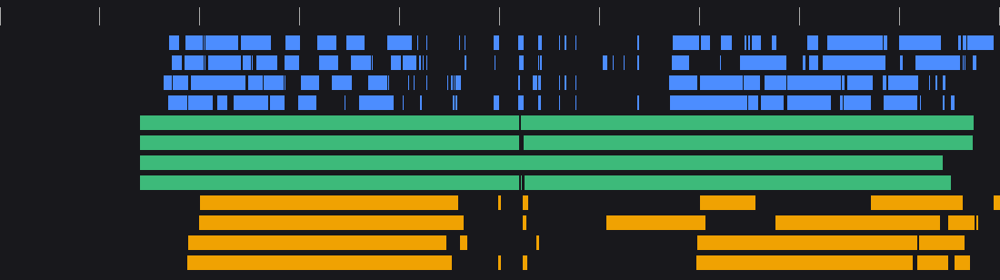
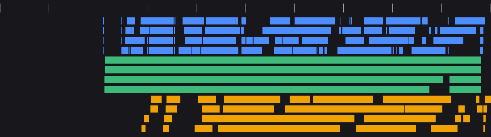
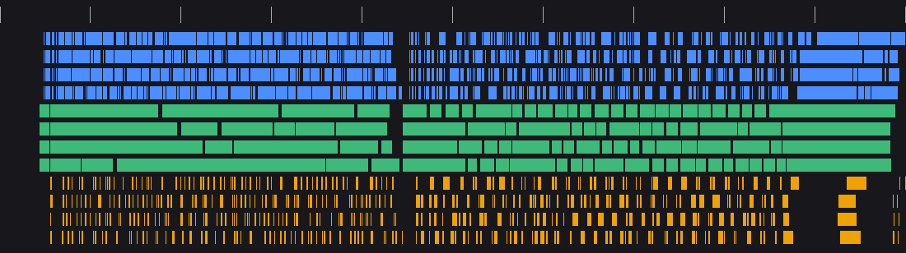
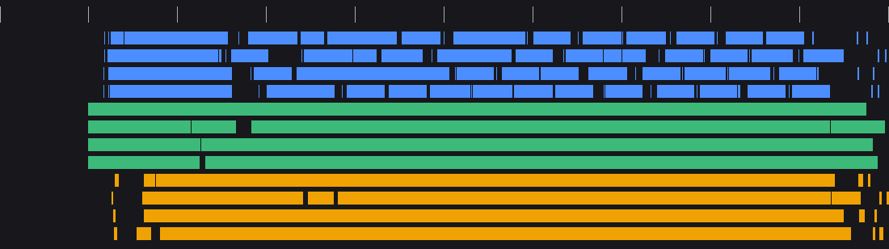

# group_norm_grad 性能汇总（PR #250 合入前后）

PR [PTO-ISA/SuperNPUBench#250](https://github.com/PTO-ISA/SuperNPUBench/pull/250) 合入（merge commit `e0abfcd`）前后，两个默认规格的 cycles、VEC IPC、带宽和流水图对比。

- **V1**：合入前库上的代码，`e21875b`；PR 中已归档到 `group_norm_grad/V1/`，不参与编译。
- **合入后**：`e0abfcd`；在用的 kernel 和测试与 PR head `d68382f` 完全一致。

## 规格

均为 FP16（`DType=__half`），4PE。

| 规格 | 测试用例 | N | C | G | HxW | D = C/G |
|---|---|---|---|---|---|---|
| HxW | `group_norm_grad_dynamic` | 2 | 16 | 8 | 2048 | 2 |
| 1D | `group_norm_grad_1d_dynamic` | 256 | 512 | 8 | 1 | 64 |

## 性能汇总

gfsim 使用 random SoC、`core.soc_lat_random_seed=2`、`--conf fourpe`、`tlsu.fake_l2_enable=false`，4 个场景均 PASS（退出码 0，有 `SuperScalar Report Stop`）。

| 规格 | 版本 | Total Cycles | 相对 V1 | `scb_waw_tile` |
|---|---|---|---|---|
| HxW | V1 | 17060 | — | 93（非 0） |
| HxW | **合入后** | **12021** | **−29.5%** | 34（非 0） |
| 1D | V1 | 55417 | — | 0 |
| 1D | **合入后** | **22651** | **−59.1%** | 17（非 0） |

### VEC IPC

每个 PE 单独统计，用 `SuperScalarModel/scripts/vec_ipc_bound.py --swim`。实测 IPC = UopNum / Vector Active Wall Cycles（union）。4 个 PE 的结果相同。

| 规格 | 版本 | UopNum/PE | Vector Active Wall | 实测 IPC | Layer-1 上限 | 预期 IPC | 相对上限 |
|---|---|---|---|---|---|---|---|
| HxW | V1 | 6244 | 10285 | 0.607 | 1.432 | 0.788 | 42.4%，BELOW |
| HxW | 合入后 | 6314 | 8371 | **0.754** | 1.429（FMA） | 0.786 | 52.8%，BELOW |
| 1D | V1 | 30220 | 47714 | 0.633 | 1.248 | 0.624 | 50.7%，BELOW |
| 1D | 合入后 | 14604 | 18562 | **0.787** | 1.186（FMA） | 0.771 | 66.4%，**IN BAND** |

### 带宽

由 SwimLane 中每次 TLOAD/TSTORE 的有效字节数（`lb0×lb1×lb2×dtype`）统计。理论读、写各 156 B/cycle，即 249.6 GB/s @1.6 GHz。“最忙窗口”是按 200 拍窗口近似估算的。

| 规格 | 版本 | 读 / 写总量 | 平均读带宽 | TLOAD 在途时段读带宽 | 最忙 200 拍窗口 | 平均写带宽 |
|---|---|---|---|---|---|---|
| HxW | V1 | 513 / 128 KiB | 30.8 B/cyc（19.7%） | 38.1 B/cyc（24.4%） | 约 151 B/cyc | 7.7 B/cyc（4.9%） |
| HxW | 合入后 | 513 / 128 KiB | **43.7 B/cyc（28.0%）** | 59.5 B/cyc（38.2%） | 约 155 B/cyc | 10.9 B/cyc（7.0%） |
| 1D | V1 | 2104 / 274 KiB | 38.9 B/cyc（24.9%） | 41.8 B/cyc（26.8%） | 约 156 B/cyc | 5.1 B/cyc（3.2%） |
| 1D | 合入后 | **568** / 290 KiB | 25.7 B/cyc（16.5%） | 29.4 B/cyc（18.8%） | 约 105 B/cyc | 13.1 B/cyc（8.4%） |

- **1D**：读量从 2104 KiB 降到 568 KiB，dY/X 只读一遍。IPC 进入合格区间，读带宽只用了 16.5%，现在主要受 vector 限制。
- **HxW**：读量不变，dY/X 仍各读两遍。时间缩短后平均带宽从 19.7% 提到 28.0%，最忙窗口已接近满带宽，但 load 仍是阵发式的。

## PR #250 的主要改动

1. **HxW**：HxW 可折叠为 `[fa≤32, 2^k]` 时，Stage 1–3 按 (n,g) 融合（`group_fused`）。ds/db、c2/c3 留在寄存器，消掉每个 batch 两次经 GM 的读回（tile store 不能 forward，每次 1000–1300 拍）。
2. **1D**：A1/A2 一次加载同一 group 的 32 个 batch，tile 为 `[32, D]`，取代原来每次只加载一行 1 KiB 的做法。当 D 是不超过 128 的 2 的幂、G ≥ 4 且 N ≤ 1024 时，每个 group 一遍完成 c2/c3、dX 和 dgamma/dbeta 部分和。部分和经 workspace 中转，原因是跨迭代的 tile 会被 zero-mask `PseudoEmptyTile` 占位错误引用，见 [LinxISA/llvm-project#130](https://github.com/LinxISA/llvm-project/issues/130)。
3. `with_cols` 改为 `always_inline`，lambda 按值捕获，消除经指针的二次读内存。
4. 删除 kernel 内的 tiling 校验，校验后续放到 tiling 侧。
5. Stage 4 按 2 的幂分列，修复 D=6 在 gfrun 中的断言，见 [LinxISA/SuperScalarModel#1005](https://github.com/LinxISA/SuperScalarModel/issues/1005)。
6. 合入前的实现归档到 `V1/`，仅作为优化过程记录。

精度（gfrun + compare，`res_check=on`，`softcore.multiThreadNum=4`）：HxW 8 个、1D 11 个用例全部 PASS。

## 流水图

蓝色为 Vector，绿色为 TLOAD，橙色为 TSTORE，每行一个 PE。完整 trace 是同名 `.json.gz`，解压后可在 [ui.perfetto.dev](https://ui.perfetto.dev) 打开。

### HxW（N2 C16 G8 HxW2048）

V1，17060 cycles：



合入后，12021 cycles：



### 1D（N256 C512 G8）

V1，55417 cycles：



合入后，22651 cycles：



## 复现

```bash
# SuperNPUBench
cd benchmark/one-level-arch/test/solution/normalization/group_norm_grad
make baremetal=off TESTCASE=group_norm_grad_dynamic COMPILER_DIR=<toolchain>/bin \
  DType=__half N_BATCH=2 C_CH=16 G_GRP=8 HxW_SZ=2048 PE_NUM=4 diss
make baremetal=off TESTCASE=group_norm_grad_1d_dynamic COMPILER_DIR=<toolchain>/bin \
  DType=__half N_BATCH=256 C_CH=512 G_GRP=8 PE_NUM=4 diss
# V1：加 CASE_SRC_DIR=solution/normalization/group_norm_grad/V1/src

# SuperScalarModel 仓库根目录
./bin/gfsim -f <elf> --conf fourpe --pto-v02 true -s tlsu.fake_l2_enable=false \
  -s core.soc_random=true -s core.soc_lat_random_seed=2
```

版本和 ELF 哈希见 `SOURCE.txt`。

SwimLane 由打了 [LinxISA/SuperScalarModel#992](https://github.com/LinxISA/SuperScalarModel/issues/992) 补丁的 gfsim 生成（a072ea3 + TLOAD 窗口按 stid 匹配），因此 TLOAD 按 PE 归属正确。4 个场景的 cycles 与原版 gfsim 一致。
